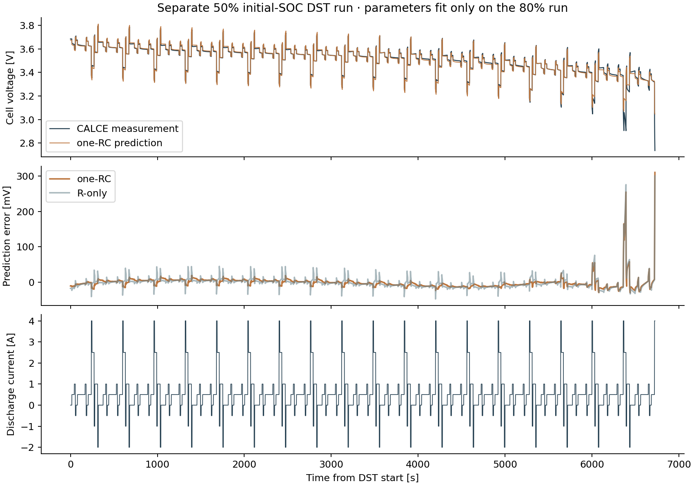

# PackBench

Measured cell-test reduction, a separate-run voltage-model check and a small C
telemetry core. The engineering question is whether a usable energy/voltage claim
survives the data provenance, specimen identity, acquisition and pack-mass details.



CALCE supplies the laboratory measurements. This project supplies the reduction,
model, tests and telemetry code; it did not collect or fabricate the cells.

| Executed result | Evidence |
| --- | --- |
| Integrated SP20-1 discharge: 2.0092 Ah, 7.1781 Wh | [Reduction](results/cell_report.md); within 0.016% of recorded cycler counters |
| One-RC prediction on a separate SP20-2 DST run: 16.0 mV RMS | [Metrics](results/metrics.json); 18.3 mV R-only baseline; 310.3 mV maximum error retained |
| Illustrative 24S40P screen: 51.84 kg, 5513 Wh usable | [Pack calculation](results/pack_report.md); assumed overhead and operating limits |
| C encoder and independent Python decoder | Host tests, CRC, timer/sequence wrap, loss, truncation, signs and invalid-input checks |
| Cortex-M0+ target compilation | [Compiler log](results/arm.log); relocatable ARM object, not a board image or MCU run |

The pack example exposes an assumption that matters more than a small fit gain:
this cell supplies about 159.5 Wh/kg at cell level. With an assumed 20% overhead,
the gross-pack value is 132.9 Wh/kg. It cannot support a 190 Wh/kg pack assumption.
The pack screen holds mission demand fixed; aircraft mass/drag closure is separate.

## Reproduce

Python 3.10+, a C compiler and Clang with the ARM target are needed. The public
archives total about 6.6 MB and are downloaded from the provider, not redistributed.

```sh
python3 -m venv .venv
. .venv/bin/activate
python -m pip install -r requirements-tested.txt
python -m pip install -e .
make evidence
```

`make evidence` runs numerical/packet tests, host sanitizers, target compilation
and the CALCE study. It fails on any failed command. Logs, source/artifact hashes,
data URLs and a local requirement-to-evidence register are retained. Individual
targets are `make test`, `make arm`, `make sanitize` and `make study`.

## Boundaries worth reading

The 80% initial-SOC DST run fits the model; the 50% run is evaluated afterward.
Both belong to SP20-2. The capacity file is SP20-1 and is not silently assigned
to the second cell. Nominal capacity and initial SOC remain explicit priors.
The large low-SOC test error stays visible beside RMS. No chemistry, temperature,
cycle-life or high-rate aircraft qualification follows from two runs of one cell.

The telemetry code takes already-calibrated engineering units. It has no drivers,
BMS function or protection outputs. Physical sensor acquisition, target timing,
calibration, isolation and independent electrical protection remain open.

[Model](docs/model.md) · [Packet contract](docs/protocol.md) ·
[Evidence and hazards](docs/evidence.md) · [Planned bench work](docs/bench-plan.md) ·
[Review findings](docs/review.md)

Raw data: [University of Maryland CALCE](https://calce.umd.edu/data). See the data
citation in the model note. The MIT license applies to repository code.
