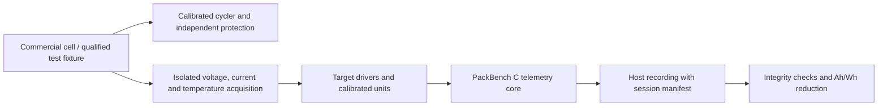

# Instrumentation and physical-test plan

Status: not executed. Use an established cell-characterization facility and
appropriately rated commercial equipment; this repository is not a charger,
electronic load, BMS or a guide to fabricating lithium-ion cells.

The sensor/driver/cycler interfaces above are planned. The C encoder, host parser,
public-data reduction and model evaluation have been executed. No driver has been
flashed to a board or connected to a cell in this project.

Before a real run, record specimen and batch IDs, equipment ratings and calibration
IDs, ambient condition, fixture revision, protocol revision and approved operating
limits. Separate commanded load from measured load. Log acquisition time, not
packet receipt time. Retain rejected packets and the reason for rejection.

Calibrate voltage/current channels against traceable references over the intended
range. Check temperature placement and response separately. Independent hardware
protection and emergency isolation must function without this telemetry software.
Have the facility review the setup and fault procedures before energizing it.

Start by comparing a recorded reference stimulus through the full acquisition
path. Then verify timestamp/sequence behavior and known load steps with the actual
instruments. Preserve raw measurements, session metadata, rejected records,
calibration data, reduction output and findings as one run package.

After each run, describe the observed failure or discrepancy, its likely cause,
the change made and the next discriminating test. Do not tune calibration factors
or model coefficients to hide a failed physical check.
